# NEGARA DIATAS AWAN — Animation Series Pipeline

> **Negara fiksi kolaboratif dibangun dari komentar netizen.**  
> Episode 3 menit, upload 2×/minggu, pejabat dipilih dari kolom komentar.

---

## 🎯 Konsep Singkat

| Aspek | Detail |
|-------|--------|
| **Nama Negara** | NEGARA DIATAS AWAN |
| **Format** | Animasi low-poly 3D (Remotion + Three.js) |
| **Durasi** | 3 menit per episode |
| **Jadwal** | Rabu & Sabtu, 19:00 WIB |
| **Partisipasi** | Komentar: `NAMA \| JABATAN \| ALASAN` → jadi pejabat |
| **Platform** | YouTube, Instagram Reels, Facebook Reels, TikTok, Telegram |

---

## 🏗️ Arsitektur Proyek

```
negara-awan/
├── packages/
│   ├── core/                    # Shared types, constants, utilities (TypeScript)
│   ├── assets/                  # glTF models, textures, audio (git-lfs)
│   ├── episodes/
│   │   ├── ep01-pendirian/      # Episode 1: Pendirian + Buka Pendaftaran
│   │   ├── ep02-kabinet/        # Episode 2: Kabinet Pertama (auto-generated)
│   │   └── ep##-.../            # Episode selanjutnya
│   └── render-pipeline/         # Render, compress, upload scripts
├── tools/
│   ├── comment-scraper/         # Scrape YT/IG/FB/TikTok → Google Sheets
│   ├── llm-scorer/              # LLM scoring komentar (OpenRouter/GPT-4o-mini)
│   └── sheet-sync/              # Sheets → officials.json, lore.json, episode template
├── docs/
│   ├── lore-bible.md            # Kanon resmi negara (wajib konsisten)
│   ├── visual-style.md          # Style guide: warna, camera, asset, AI prompts
│   └── production-calendar.md   # Jadwal, timeline, KPI, cron jobs
└── package.json                 # Workspace root (npm workspaces)
```

---

## 🚀 Quick Start

### Prerequisites
- **Node.js 18+** (tested on 20)
- **FFmpeg** (untuk compress)
- **yt-dlp** (untuk scrape YouTube: `pip install yt-dlp`)
- **ComfyUI** running di `http://127.0.0.1:8188` (asset generation)
- **VoiceStudio** running di `http://127.0.0.1:3900` (voiceover)
- **GPU:** RTX 3050 6GB (sequential GPU tasks only)

### Install
```bash
cd ~/Documents/negara-awan
npm install
```

### Environment Variables (`.env` di root)
```env
# Google Sheets (service account)
GOOGLE_SHEET_ID=your_sheet_id
GOOGLE_SERVICE_ACCOUNT_KEY=./service-account.json

# LLM Scoring (OpenRouter)
OPENAI_API_KEY=sk-or-xxxx
OPENAI_BASE_URL=https://openrouter.ai/api/v1
SCORING_MODEL=openai/gpt-4o-mini

# YouTube OAuth
YOUTUBE_CLIENT_ID=xxx
YOUTUBE_CLIENT_SECRET=xxx
YOUTUBE_REFRESH_TOKEN=xxx

# Instagram/Facebook Graph API
INSTAGRAM_ACCESS_TOKEN=xxx
INSTAGRAM_USER_ID=xxx
FACEBOOK_ACCESS_TOKEN=xxx
FACEBOOK_PAGE_ID=xxx

# Telegram Bot
TELEGRAM_BOT_TOKEN=xxx
TELEGRAM_CHAT_ID=@botax_claude_bot
```

### Development
```bash
# Episode 1: buka Remotion Studio (live preview)
npm run dev:ep1

# Render Episode 1 (production quality)
npm run build:ep1

# Full pipeline: scrape → score → sync → render → compress → upload
npm run scrape:comments
npm run score:comments
npm run sync:sheet
npm run build:ep1
node packages/render-pipeline/compress.js packages/episodes/assets/video/ep01-pendirian.mp4 -tg
node packages/render-pipeline/upload.js packages/episodes/assets/video/ep01-pendirian.mp4 ep01-pendirian
```

---

## 🔄 Production Workflow (Per Episode)

```mermaid
graph LR
    A[Episode N Upload] --> B[Scrape Komentar 7 hari]
    B --> C[LLM Scoring]
    C --> D[Sync ke Sheets]
    D --> E[Generate Officials & Lore]
    E --> F[Script & Storyboard Ep N+1]
    F --> G[Asset Gen ComfyUI]
    G --> H[Voiceover VoiceStudio]
    H --> I[Animate Remotion]
    I --> J[Render & Compress]
    J --> K[Upload Multi-platform]
    K --> A
```



### Detail Steps

| Step | Command | Output | Waktu |
|------|---------|--------|-------|
| 1. Scrape | `npm run scrape:comments` | `Comments` sheet + backup JSON | 5-10 menit |
| 2. Score | `npm run score:comments` | Score + tier di sheet | 2-5 menit |
| 3. Sync | `npm run sync:sheet` | `officials.json`, `lore.json`, episode template | <1 menit |
| 4. Script | Manual | `episode.json` (script, timing) | 30-60 menit |
| 5. Asset | ComfyUI batch | `.glb` models, textures | 15-30 menit |
| 6. Voice | VoiceStudio | `.wav` voiceover lines | 5-10 menit |
| 7. Animate | Remotion Studio | Scene components | 1-3 jam |
| 8. Render | `npm run build:ep{N}` | `video.mp4` (1080p) | 30-60 menit |
| 9. Compress | `node compress.js` | `video-tg.mp4` (720p, <50MB) | 2-3 menit |
| 10. Upload | `node upload.js` | YT/IG/FB/TG + TikTok manual | 10-20 menit |

---

## 🎨 Asset Generation (ComfyUI)

### Workflow yang Dibutuhkan
1. **Low-poly building** → `building_batch.json` (5-10 varian)
2. **Character avatar** → `avatar_batch.json` (seed per pejabat)
3. **Flag/Emblem** → `flag_emblem.json` (SVG → GLB)
4. **UI Hologram** → `ui_hologram.json` (panel, card, scroll)

### Contoh Prompt Building
```json
{
  "prompt": "low poly stylized cloud city building, geometric tower, cylindrical with conical roof, glowing windows, pastel blue white yellow palette, flat shading, hard edges, vertex colors, no textures, isometric view, unity game asset style",
  "negative_prompt": "photorealistic, pbr, round shapes, organic, high poly, realistic lighting, shadows, textures",
  "width": 512, "height": 512, "steps": 20, "cfg": 3.5,
  "sampler": "euler", "scheduler": "normal"
}
```

---

## 🎙️ Voiceover (VoiceStudio)

### Profiles
| Karakter | Profile | Settings |
|----------|---------|----------|
| **Narrator** | `Siti` (calm, professional) | Speed 1.0, Pitch 0 |
| **Presiden** | Custom `Presiden` (Owner voice clone) | Speed 0.95, Pitch +2 |
| **System** | `Demo Voice` (robotic, neutral) | Speed 1.1, Pitch -3 |

### Script Format (per line di `episode.json`)
```json
{
  "id": "s04_sumpah",
  "speaker": "presiden",
  "text": "Dengan nama angin yang tak terlihat, aku bersumpah...",
  "durationSec": 12,
  "animationNotes": "Presiden angkat tangan, partikel cahaya naik",
  "cameraNotes": "Medium close-up → wide shot",
  "audioCue": "sfx_sumpah_glow.mp3, musik_epik_naik.mp3"
}
```

---

## 📊 Data Schema (Zod validated)

### `episode.json` — Episode Metadata
```typescript
{
  nomor: 1,
  judul: "Pendirian NEGARA DIATAS AWAN",
  durasiTargetDetik: 180,
  script: ScriptLine[],
  officialsBaru: Official[],
  loreUpdate: Partial<Lore>,
  assets: { models, textures, audio },
  renderSettings: { resolution: [1920,1080], fps: 30, crf: 22 },
  uploadTargets: ["youtube","instagram","facebook","tiktok"],
  status: "draft" | "production" | "rendering" | "uploading" | "published"
}
```

### `officials.json` — Pejabat Terpilih
```typescript
{
  id: "nda_...",
  nama: "Budi",
  jabatan: "Menteri Gravitasi",
  alasan: "Supaya orang tidak jatuh ke bumi saat tidur",
  sumber: { platform, commentId, authorHandle, likes, timestamp },
  status: "dipilih",
  episodeMasuk: 1,
  avatarSeed: "seed_...",
  warnaTema: "#7DD3FC"
}
```

### `lore.json` — Kanon Negara (Update tiap episode)
```typescript
{
  versi: 2,
  namaNegara: "NEGARA DIATAS AWAN",
  kabinet: [{ jabatan, nama, officialId }],
  populasi: 50,
  geografis: { provinsi: ["Awan Barat", "Stratos Selatan"] },
  updatedAt: "2026-11-25T00:00:00.000Z"
}
```

---

## 🤖 Automation (Cron Jobs)

```bash
# Setup via cronjob_manage skill atau systemd
# Selasa 02:00 - Scrape & Score
# Rabu 02:00 - Sync Sheet
# Minggu 03:00 - Render episode berikutnya (GPU idle)
```

---

## 📱 Platform Specifics

| Platform | Format | Khusus |
|----------|--------|--------|
| **YouTube** | 1920×1080, 3:00 | Full horizontal, thumbnail custom, end screen |
| **Instagram Reels** | 1080×1920, 3:00 | Vertical crop (safe zone 4:5), caption + hashtag |
| **Facebook Reels** | 1080×1920, 3:00 | Same as IG, cross-post dari IG |
| **TikTok** | 1080×1920, 3:00 | **MANUAL ONLY**, cover custom, pinned comment format |
| **Telegram** | 720×1280, 3:00 | Compressed CRF24 <50MB, send via Bot API |

---

## 🛡️ Hard Rules (Non-negotiable)

1. **Negara tidak pernah mendarat** — metafora & visual
2. **Pemilihan via komentar only** — tidak ada voting external
3. **1 akun = 1 entri** — anti spam, dedup by handle
4. **Konstitusi 3 pasal** — tidak berubah, hanya amend via musyawarah
5. **Presiden = Owner** — tidak digantikan
6. **TikTok upload manual** — Playwright unreliable
7. **GPU sequential** — RTX 3050 6GB, no parallel ComfyUI + Render
8. **Posting jam 11:30-13:00 atau 18:30-21:00 WIB** — prime time
9. **Label AI content** — wajib di caption/video

---

## 📈 Roadmap

### Phase 1: Foundation (Ep 1-4) ✅ **IN PROGRESS**
- [x] Project structure & core types
- [x] Episode 1 boilerplate (script, scenes, data)
- [x] Comment scraper + LLM scorer + sheet sync
- [x] Render pipeline (render, compress, upload)
- [x] Docs: lore-bible, visual-style, production-calendar
- [ ] ComfyUI workflows untuk asset base
- [ ] VoiceStudio profile "Presiden"
- [ ] Episode 1 render & upload test

### Phase 2: Automation (Ep 5-12)
- [ ] Cron jobs setup
- [ ] Auto-storyboard dari officials.json
- [ ] Asset library management (versioning)
- [ ] Analytics dashboard (views, komentar, pejabat)

### Phase 3: Scale (Season 2+)
- [ ] Multi-language (EN subtitle default)
- [ ] Merch integration (NFT avatar, digital passport)
- [ ] Crossover dengan creator lain
- [ ] Web interactive: eksplorasi Stratos 3D

---

## 🤝 Contributing

Owner only. Tapi ide & feedback welcome di kolom komentar video!

---

## 📄 License

Proprietary — Owner exclusive. Asset & lore tidak untuk komersial tanpa izin.

---

## 🔗 Links

- **Repo:** `~/Documents/negara-awan`
- **ComfyUI:** `http://127.0.0.1:8188`
- **VoiceStudio:** `http://127.0.0.1:3900`
- **Google Sheets:** (link di env)
- **Telegram Bot:** `@botax_claude_bot`

---

> **"Negara ini tidak punya tanah. Hanya awan, kode, dan kalian."**  
> — *Narrator, Episode 1*